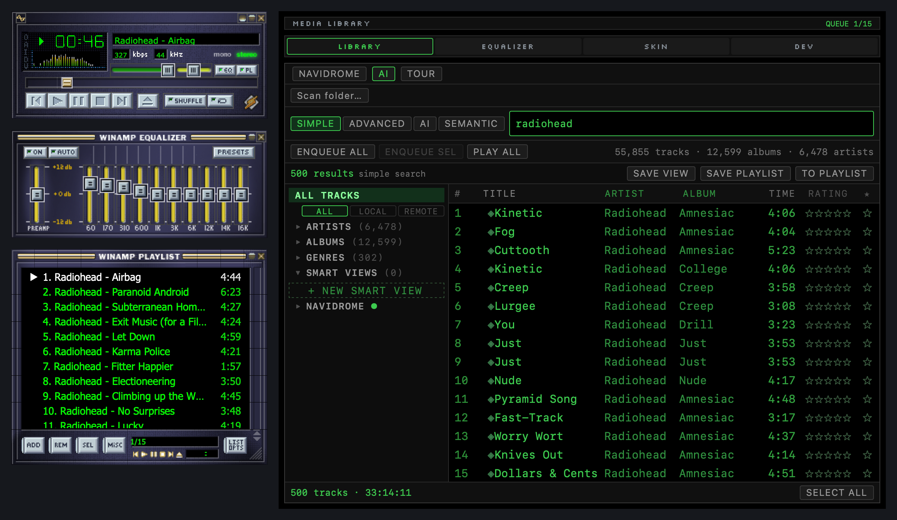

  

<h1 align="center">NaVinaMP</h1>

  A Winamp-style player for your local music and your Navidrome library.

  Browse both collections together, queue an album, and play it gaplessly. 
  The original Winamp 2.91 skin comes bundled, and you can load your favorite
  <code>.wsz</code> skin.

  <a href="https://github.com/prop/navinamp/releases/latest"><strong>Download for macOS, Windows, or Linux</strong></a>

  

## Highlights

### Your music in one library

Local folders and Navidrome servers are browsed as one library, with one
search over both. Favorites and ratings are synced to the server.

### Make it look like your Winamp

The original Winamp 2.91 skin is the default, and any classic `.wsz` skin
loads from the Media Library's **SKIN** tab: copy the file into the skins
folder and press the rescan button there. The player, playlist, equalizer,
and library windows snap together and move as one.

### Play an album front to back

Gapless playback with ReplayGain and a 10-band equalizer. The queue and your
position in a track survive a restart.

Search goes further when you want it: full-text and field rules, semantic
search by meaning, and AI search that writes the rules for you, with optional
Discogs lookups. AI and semantic search send some library metadata to the
provider you configure; see [Privacy and credentials](#privacy-and-credentials).

Also built in: media keys, desktop notifications, global shortcuts for now
playing and next track, and URL streams, with YouTube links through your own
`yt-dlp` install.

## Play your first track

**From a folder.** Open the **Media Library** and press **Scan folder…** above
the track list, then pick the folder that holds your music. Tracks appear as
they are found. Double-click one to play it.

**From Navidrome.** In the Media Library, choose **NAVIDROME → SERVER STATUS**
and press **+ ADD SERVER**. Enter the server address and your account, then
press **ADD & CONNECT**. The library syncs on its own, and its tracks appear
next to your local ones. The password is stored in plain text; see
[Privacy and credentials](#privacy-and-credentials).

## Download

| | macOS | Windows | Linux |
|---|---|---|---|
| Installer | `.dmg` | `.msi`, `-setup.exe` | `.deb`, `.rpm`, `.AppImage` |
| Needs at runtime | nothing beyond macOS | WebView2, downloaded by the installer when missing | WebKitGTK 4.1 and GTK 3, installed by the `.deb` |

All builds are x86-64; on Apple Silicon Macs the app runs through Rosetta 2.
The latest release is at <https://github.com/prop/navinamp/releases/latest>.

Installation help

- **macOS:** open the `.dmg` and copy `NaVinaMP.app` to `/Applications`.
- **Windows and Linux:** run the installer for your system.

At present the installers are not code-signed with a developer certificate.
On macOS the app is ad-hoc signed and not notarized, so Gatekeeper refuses
it at first: allow the app under **System Settings → Privacy & Security**
(**System Preferences → Security & Privacy** on macOS 12 or earlier).

## Navidrome

NaVinaMP supports multiple saved Navidrome and Subsonic servers; their
libraries are synced into one combined local database.

- **Quick rescan** fetches only new or changed albums; **Full rescan**
  re-fetches every album.
- Remote tracks support now-playing and submission scrobbles, star/unstar,
  rating sync, and publishing smart views as Navidrome playlists.
- A Navidrome server also provides label and catalog number for albums and
  for the track card in a row's context menu, plus the real file path behind
  **Copy path**. These come from Navidrome's own API, over `https://` only.

## Privacy and credentials

- Navidrome credentials are stored **in plaintext** at
  `<app_data_dir>/navidrome.json`, and AI search keys and the optional
  Discogs token at `<app_config_dir>/ai.json`.
- Navidrome's own API is signed in to with that password, sent as itself
  rather than as a salted token, so NaVinaMP uses it only over `https://`.
  An `http://` server gets no label, catalog number, or real file path.
- Stream URLs contain Subsonic authentication tokens. NaVinaMP does not log
  them and scrubs them from errors, but do not paste them publicly.
- Servers using self-signed certificates must enable
  **allow self-signed certificates** for that profile.
- With AI features enabled, the configured provider receives library
  metadata. AI search sends counts, genres, sampled artist names, and for
  each saved server its display name (`user@host` unless you set a label),
  its id, and its track count; SEMANTIC indexing sends each track's title,
  artist, album, genre, and year, or the bare file name when all of those
  are empty.

NaVinaMP keeps its files in two directories named `com.prop.navinamp`. With
the current Tauri and `dirs` versions they are one directory on macOS
(`~/Library/Application Support/`) and Windows (`%APPDATA%`), and two on
Linux (`~/.config/` and `~/.local/share/`).

| Directory | Contents |
|---|---|
| `<app_data_dir>` | `navinamp.db` (library), `library-roots.json`, `art-cache/`, `navidrome.json` (servers), `queue.json`, `playback.json` |
| `<app_config_dir>` | `audio.json` (volume, EQ, preferences), `windows.json`, `ai.json` (AI provider), `streams.json` (`yt-dlp` path), `skins/` |

A few interface preferences, such as the selected skin and the UI scale, are
kept in the webview's local storage instead.

## Contributing

Building from source, the checks CI runs, how releases are made, and the code
layout are in [CONTRIBUTING.md](CONTRIBUTING.md).

## License

[MIT](LICENSE)
