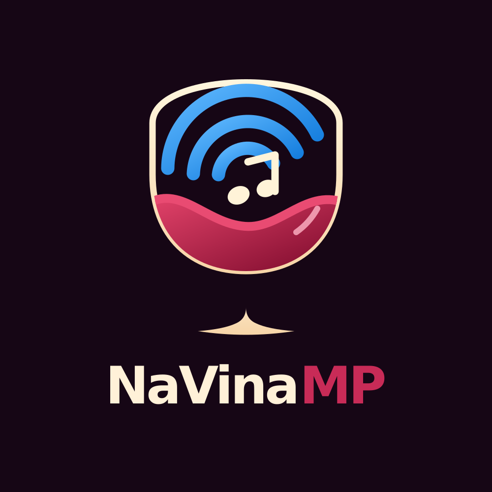

<p align="center">
  
</p>

<h1 align="center">NaVinaMP</h1>

<p align="center">
  A Winamp-inspired desktop music player for local libraries and Navidrome.
</p>

---

NaVinaMP is a desktop music player built with **Tauri 2**, **Svelte 5**, and
**Rust**. It combines a classic four-window player layout with a modern
library: local folders, Navidrome servers, smart views, skins, an equalizer,
gapless playback, and AI-assisted search.

## Download

Each release on <https://github.com/prop/navinamp/releases> carries
installers for macOS (`.dmg`), Windows (`.msi` and `-setup.exe`), and Linux
(`.deb`, `.rpm`, and `.AppImage`). On macOS, open the `.dmg` and copy
`NaVinaMP.app` to `/Applications`.

Released builds need no toolchain. macOS uses its built-in WebKit. Windows
needs the WebView2 runtime, which the installer downloads when it is
missing. Linux needs WebKitGTK 4.1 and GTK 3, which the `.deb` declares as
dependencies.

All builds are x86-64; the macOS app runs on Apple Silicon through Rosetta 2.
At present none is code-signed with a developer certificate: the macOS app
is ad-hoc signed and not notarized, so if Gatekeeper refuses it, allow the
app under **System Settings → Privacy & Security** (**System Preferences →
Security & Privacy** on macOS 12 or earlier).

## Highlights

- **Four-window Winamp-style interface**
  - Player, playlist editor, media library, and equalizer
  - Windowshade mode, always on top, and edge snapping that moves docked
    windows together
- **Local music library**
  - Incremental scanning by folder
  - Artists, albums, genres, ratings, favorites, and smart views
- **Navidrome / Subsonic support**
  - Multiple saved servers in one combined local and remote library
  - Quick and full rescans, server playlists, smart-view publishing
  - Ratings, favorites, and scrobbles synced with the server
- **Playback**
  - Gapless playback and ReplayGain
  - 10-band equalizer with user presets and auto-headroom, and a spectrum
    analyzer
  - Queue and playback position restored on the next launch
  - Remote streams reconnect instead of skipping the track
- **Playlist and search**
  - Follow current track, "Play next", and URL streams, including YouTube
    links through your own `yt-dlp` install
  - SIMPLE (full-text), ADVANCED (field rules), SEMANTIC (embeddings from an
    OpenAI-compatible provider), and AI search that writes the rules, with
    optional Discogs catalog lookups
- **Skins**
  - Classic Winamp 2 `.wsz` skins, with the original 2.91 base skin bundled
    as the default, a built-in fallback, and a curated popular-skins pack
- **Desktop integration**
  - Media keys, Now Playing metadata, and desktop notifications
  - Global shortcuts for now playing (Ctrl+⌘O or Ctrl+Alt+O) and next track
    (Ctrl+⌘N or Ctrl+Alt+N)
  - `Alt+L` toggles the Media Library, `Alt+S` cycles the UI scale, and
    ⌘/Ctrl+U adds a URL in the playlist

The **Window** menu toggles the three extra windows and Always on Top
(⌘⇧L, ⌘⇧E, ⌘⇧P, ⌘⇧T; Ctrl+Shift+… elsewhere) and holds two preferences:
**Notify on Track Change** (on by default) and **Resume Playback on Launch**
(off by default).

## Building from source

None of this is needed to run a released build; see [Download](#download).
You need Node.js 20.19+ or 22.12+ with npm, Rust stable, and the
[Tauri 2 prerequisites][tauri-prereq].

```sh
npm install
npm run tauri dev      # development
npm run tauri build    # installers for the current platform
```

CI runs these on every pull request:

```sh
npm run build
cargo test --workspace
cargo fmt --all -- --check
cargo clippy --workspace --all-targets -- -D warnings
```

There is no JavaScript test runner or type-check step.

## Navidrome

Open the **Media Library** window, choose **NAVIDROME → SERVER STATUS**, and
add a server. NaVinaMP supports multiple saved Navidrome/Subsonic servers;
their libraries are synced into one combined local database.

- **Quick rescan** fetches only new or changed albums; **Full rescan**
  re-fetches every album.
- Remote tracks support now-playing and submission scrobbles, star/unstar,
  rating sync, and publishing smart views as Navidrome playlists.
- A Navidrome server also provides label and catalog number for albums and
  for the track card in a row's context menu, plus the real file path
  behind **Copy path**. These come from Navidrome's own API, over `https://`
  only.

## Data and settings files

NaVinaMP keeps its files in two directories named `com.prop.navinamp`. With
the current Tauri and `dirs` versions they are one directory on macOS
(`~/Library/Application Support/`) and Windows (`%APPDATA%`), and two on
Linux (`~/.config/` and `~/.local/share/`).

| Directory | Contents |
|---|---|
| `<app_data_dir>` | `navinamp.db` (library), `library-roots.json`, `art-cache/`, `navidrome.json` (servers), `queue.json`, `playback.json` |
| `<app_config_dir>` | `audio.json` (volume, EQ, preferences), `windows.json`, `ai.json` (AI provider), `streams.json` (`yt-dlp` path), `skins/` |

A few interface preferences, such as the selected skin and the UI scale,
are kept in the webview's local storage instead.

## Security notes

- Navidrome credentials are stored **in plaintext** at
  `<app_data_dir>/navidrome.json`, and AI search keys and the optional
  Discogs token at `<app_config_dir>/ai.json`.
- Navidrome's own API is signed in to with that password, sent as itself
  rather than as a salted token, so NaVinaMP uses it only over `https://`.
  An `http://` server gets no label, catalog number, or real file path.
- Stream URLs contain Subsonic authentication tokens. NaVinaMP does not log
  them and scrubs them from errors, but do not paste them publicly.
- Servers using self-signed certificates must enable
  **allow self-signed certificates** for that profile.
- With AI features enabled, the configured provider receives library
  metadata. AI search sends counts, genres, sampled artist names, and for
  each saved server its display name (`user@host` unless you set a label),
  its id, and its track count; SEMANTIC indexing sends each track's title,
  artist, album, genre, and year, or the bare file name when all of those
  are empty.

## Skins

NaVinaMP loads classic Winamp 2 `.wsz` skins. The original Winamp 2.91 base
skin ships with the app and is the default; a minimal fallback is built in.
The Media Library's **SKIN** tab lists installed skins, rescans the folder
below, and downloads a curated pack from the Winamp Skin Museum on
archive.org only when you ask.

```text
<app_config_dir>/skins
```

The selected skin is remembered by the webview, not in that folder.

## Releases

Releases are generated with [release-please] from
[Conventional Commits] on `master`:

| Commit message | Version bump |
|---|---|
| `fix: …` | patch |
| `feat: …` | minor |
| `feat!: …` / `BREAKING CHANGE:` | major |
| `chore:`, `ci:`, `docs:`, `refactor:` | none |

Merging the release PR bumps the version, updates `CHANGELOG.md`, and
creates the tag and the GitHub release. Two follow-ups are needed each
time: the tag is created with `GITHUB_TOKEN`, which starts no workflow, and
release-please does not touch `Cargo.lock`.

1. Run the **CI** workflow on the new tag (Actions → CI → Run workflow). It
   builds and attaches the installers.
2. Run `cargo update -w` and commit the result, otherwise `--locked` builds
   fail.

[release-please]: https://github.com/googleapis/release-please
[Conventional Commits]: https://www.conventionalcommits.org/
[tauri-prereq]: https://v2.tauri.app/start/prerequisites/

## Project layout

```text
src/                     Svelte 5 frontend: window views, components, player queue
src-tauri/               Tauri shell: IPC commands, audio bridge, windows, menus
src-tauri/resources/     Bundled base skin and the popular-skins manifest
crates/navinamp-audio    Playback engine: decode, DSP, EQ, output, remote streams
crates/navinamp-library  Scanner, SQLite library, queries, remote sync
crates/navinamp-subsonic Subsonic/OpenSubsonic client and Navidrome's native API
crates/navinamp-skin     Winamp skin parsing and validation
crates/navinamp-llm      LLM adapters for AI search
assets/                  Brand assets and the fallback skin's sources
scripts/, .github/       CI scripts, workflows, release-please, version stamping
```

## Contributing

Every change goes through a pull request from a topic branch and is merged
after CI passes. [AGENTS.md](AGENTS.md) has the workflow.

## License

[MIT](LICENSE)
